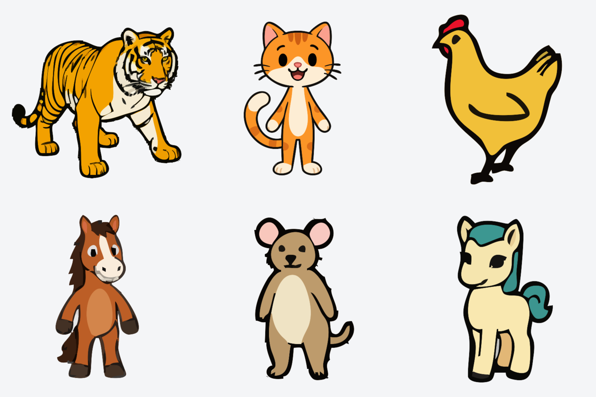
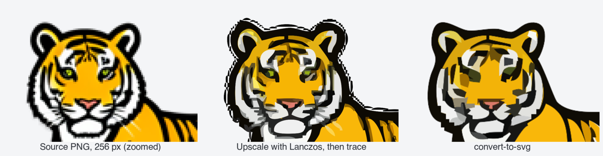

<h1 align="center">convert-to-svg</h1>

<p align="center">
  <b>Turn PNG / JPG / WebP icons into clean, scalable SVG — in one command.</b><br>
  An agent skill for <b>Claude Code</b> and <b>Codex</b> that is also a plain bash script.
</p>

<p align="center">
  
  
  
  
</p>

<p align="center">
  
</p>

---

## Why this exists

[vtracer](https://github.com/visioncortex/vtracer) turns raster images into SVG very well, but the obvious "prepare the image first" steps can ruin the result:

- **Upscaling a small icon with Lanczos** rings on the edge of the alpha channel, and the tracer faithfully draws that ringing as a **ragged, dashed halo around the outline**.
- **Flood-filling the background of an image that is *already transparent*** only adds more fringe.

<p align="center">
  
</p>

`convert-to-svg` avoids both:

| Step | Naive pipeline | convert-to-svg |
| --- | --- | --- |
| Trace | on a Lanczos-upscaled copy | on the **original pixels** |
| Output size | resize the raster, then trace | trace, then fit the **vector** to the canvas (`viewBox` + one transform) — lossless |
| Background | always flood-fill | skipped automatically when the image is **already transparent** |

The result is the same clean outline you get from running `vtracer` by hand on the original file — plus a canvas of any size, centered.

> **Honest trade-off:** tracing the original pixels of a very small source (for example 256 px) gives a clean outline but coarser inner detail. If you want to try more detail, add `--upscale`. It enlarges the raster with a non-ringing filter first. It looked better on some of our icons and worse on others, so it is opt-in.

## Features

- **Any canvas size, centered** — `--size 512x512`, `--size 1024x768`, or keep the original with `--no-resize`. Scaling happens in the SVG, so quality never depends on the output size.
- **Smart background handling** — make a uniform background transparent (`--remove-bg`) or leave it alone (`--keep-background`). Already-transparent images are detected (all four corners) and never flood-filled.
- **Single file or whole folder** — PNG, JPG/JPEG, WebP, BMP, GIF and TIFF.
- **Explicit by design** — canvas size and background handling are *required*. The script refuses to guess, and the agent asks you instead of assuming.
- **Tunable tracing** — vtracer's `--simplify`, `--filter-speckle`, `--color-precision` and `--mode` are exposed.
- **Optional flat-icon cleanup** — `--flat-palette` removes intermediate edge colors before tracing, so flat fills and outlines can stay clean with fewer SVG paths.
- **Plain bash** — no wrapper framework. Use it from an agent or straight from your terminal.

## Requirements

- macOS (developed and tested here; the script is plain bash and may work on Linux, but that is untested)
- [vtracer](https://github.com/visioncortex/vtracer) CLI
- `python3` (used for `--size` and `--flat-palette`; no extra Python packages)
- [ImageMagick](https://imagemagick.org) (used for `--remove-bg`, `--upscale` and `--flat-palette`)

```bash
brew install imagemagick

# vtracer: the crates.io release of vtracer-cli failed to build for us, so install from git
brew install rustup && rustup-init -y && source "$HOME/.cargo/env"
cargo install --git https://github.com/visioncortex/vtracer vtracer-cli
```

## Install as an agent skill

The repository is a ready-made skill: [`SKILL.md`](SKILL.md) holds the instructions the agent follows and [`scripts/convert.sh`](scripts/convert.sh) does the work. Claude Code and Codex use the same `SKILL.md` format, so the only difference is the folder you put it in.

### Claude Code

```bash
git clone https://github.com/logdok/skill_convert_to_svg.git ~/.claude/skills/convert-to-svg
```

### Codex

[Codex supports Agent Skills](https://developers.openai.com/codex/skills) in the CLI, the IDE extension and the Codex app. Put the skill into your Codex skills folder (`$CODEX_HOME/skills`, which is `~/.codex/skills` by default):

```bash
git clone https://github.com/logdok/skill_convert_to_svg.git ~/.codex/skills/convert-to-svg
```

You can also install it with Codex's built-in skill installer by pointing it at this repository. Restart Codex if it was already running so it picks up the new skill.

### Use it

Just ask the agent in plain language — it loads the skill when the request matches:

> "Convert `icons/` to SVG, 512×512, transparent background"
> "Vectorize `logo.png`"

The agent checks your dependencies, looks at whether the source is already transparent, asks about anything you did not specify (canvas size, background, output folder) and runs the script. In Codex you can also mention the skill explicitly with `$convert-to-svg`.

## Use it as a plain script

No agent needed:

```bash
scripts/convert.sh <file-or-folder> (--size WxH | --no-resize) (--remove-bg | --keep-background) [options]
```

```bash
# one file, 512×512 canvas, transparent background, saved as cat_512.svg
scripts/convert.sh cat.png --size 512x512 --remove-bg --suffix _512

# a whole folder, original size, keep the background as is
scripts/convert.sh icons/ --no-resize --keep-background -o icons_svg

# non-square canvas — the image is fit and centered
scripts/convert.sh logo.png --size 1024x768 --keep-background
```

### Options

| Option | Description |
| --- | --- |
| `--size WxH` | Fit the SVG inside a `W×H` canvas and center it |
| `--no-resize` | Keep the original pixel dimensions |
| `--keep-background` | Trace the source as is (right for already-transparent images) |
| `--remove-bg` | Flood-fill a uniform background from the top-left pixel to transparent. Skipped automatically if all four corners are already transparent |
| `--fuzz N%` | Tolerance for `--remove-bg` (default `5%`) |
| `--flat-palette LIST` | Clean flat artwork before tracing, using explicit comma-separated `#RRGGBB` colors; forces trace color precision 8 |
| `--flat-neutral N` | Channel-spread threshold for mapping near-gray pixels to neutral palette entries (default `20`, `0` disables) |
| `--flat-alpha N` | Opacity cutoff for flat cleanup, `1`–`255` (default `128`) |
| `--upscale` | With `--size` and a smaller source: enlarge the raster (Mitchell filter) before tracing. Experimental |
| `-o, --output DIR` | Output folder (default `<input dir>/output`) |
| `--suffix STR` | Append a suffix to the file name, e.g. `_512` → `name_512.svg` |
| `--keep-prep` | Keep intermediate files (`--remove-bg` and `--upscale`) |
| `--mode` | `spline` (default), `polygon` or `none` |
| `--simplify N` | Corner simplification (default `1.5`) |
| `--filter-speckle N` | Drop speckles smaller than `N` px (default `4`) |
| `--color-precision N` | Color bits per channel (default `5`) |

## Tuning tips

### Clean outlines and small files for flat icons

If a simple drawing produces gray patches or colored fragments along its outlines, use a small palette **before tracing**. Recoloring finished paths keeps the unwanted boundaries. Include every intended solid fill and outline color; choose colors from opaque interiors, not antialias pixels.

```bash
# Example palette for one illustration; replace it with your own artwork's colors.
scripts/convert.sh icon.png --no-resize --keep-background \
  --flat-palette '#000000,#E4BC96,#009245,#4E9DC4,#3E489D,#8F0000' \
  --simplify 0.8 --filter-speckle 4 -o clean_svg
```

The cleanup keeps native dimensions, protects neutral outlines from being mapped to colored fills, and thresholds alpha into solid shapes. A tested 266×336 illustration improved from 15,841 to 4,122 bytes (74% smaller) while removing gray fragments. That example used speckle 12; start with 4 or lower for small eyes and other meaningful details. Inspect the result at normal size and zoomed in before increasing speckle filtering.

Use this mode for **opaque, flat-color illustrations**. Keep the normal pipeline for photos, gradients and translucent artwork. Include white/gray in the palette when they are intentional fills. Preserve the original file and compare silhouettes, holes, tiny details and transparency. Use an actual alpha composite as reference: hidden RGB in transparent pixels can look like visible shapes in a faulty thumbnail.

### Other adjustments

- **Ragged or fringed outline** → the raster was upscaled with Lanczos (or similar) before tracing. Trace the original.
- **Gray ring around the outline on an opaque (white-background) image** → raise `--fuzz` to about `25%`. The anti-aliased light-gray edge pixels fall outside the default `5%` tolerance, so they get traced as a ring.
- **Blocky detail on a small source** → try `--upscale` and compare with the default. It helps some images and hurts others.
- **Noisy or blobby result** → raise `--filter-speckle` or `--simplify`, lower `--color-precision`.
- **Lost detail** → lower `--filter-speckle` / `--simplify`, raise `--color-precision`.
- **Background remains** → raise `--fuzz`. The flood-fill starts at the top-left pixel, so the background needs a uniform corner.

### Small source, large output

For a small image that needs a 512×512 SVG, use `--size 512x512` without `--upscale`. The original pixels are traced first. Only the SVG canvas and one parent transform change afterward, so contours are identical to a `--no-resize` conversion with the same other options.

A 262×206 image fits in 512×512 at scale 1.9542, centered with about 54.718 units above and below. It is not stretched to a square. In the tested food illustration, all 27 paths stayed identical and resizing added less than 100 bytes to an approximately 8.7 KB SVG. The test suite verifies this for normal and flat-palette conversion, including native preparation dimensions and unchanged source bytes.

Scaling the vector does not add raster blur. Tracing itself is still an approximation: tiny details missing from the source cannot be recovered just by requesting a larger canvas.

## How it works

```
source → optional background removal → optional flat palette cleanup → vtracer → fit SVG canvas
```

`--size` rewrites the SVG header to the `width`/`height`/`viewBox` of the canvas and wraps the paths in a single `<g transform="translate(…) scale(…)">`. With `--no-resize` the tracer output is left untouched.

The flat cleanup helper uses ImageMagick and Python's standard library. Run `python3 scripts/test_flat.py` to verify alpha handling, neutral outlines, palette colors, and conversion with a non-square canvas.

## Credits

- [vtracer](https://github.com/visioncortex/vtracer) by VisionCortex does the actual tracing.
- [ImageMagick](https://imagemagick.org) handles the optional background removal and upscaling.

## License

[MIT](LICENSE)
